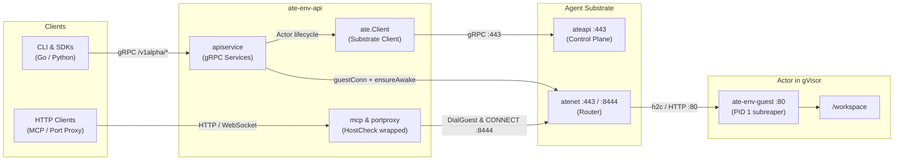
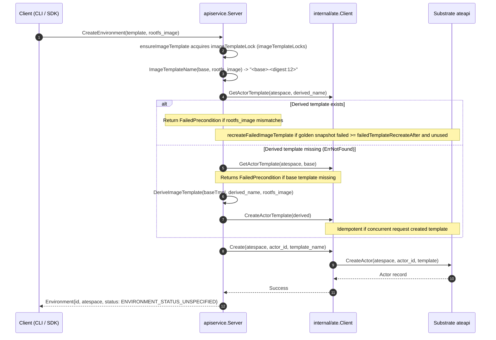
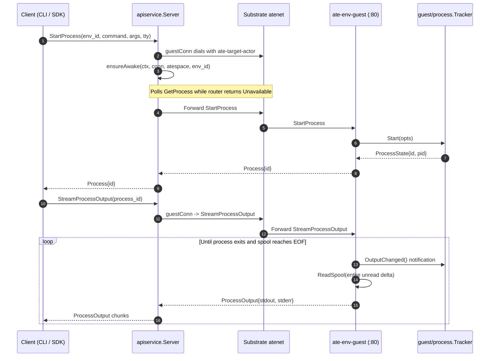

# sandboxenv-rl architecture

Status: describes `main` at `23c3647`. Re-check the claims in §Components when `internal/ate` or
`internal/apiservice` changes. Companion to [README.md](../README.md) (how to use it) and
[docs/glossary.md](./glossary.md).

## Problem

Reinforcement learning rollouts and code-agent evaluations burst hundreds of isolated environments
in parallel, then leave them idle while policy models generate completions or tokens. Traditional
Kubernetes pods occupy node memory, IP addresses, and scheduling slots while idle. Rebuilding
container images for each repository benchmark duplicates common guest binaries across the container
registry and lengthens initialization loops.

Agent Substrate addresses this workload profile. Each environment runs as a Substrate actor in
gVisor (`runsc`). When idle, actors suspend to object storage checkpoints (`gs://`) and release
worker memory and CPU.

## Overview

Clients interact with `ate-env-api`, which runs as a Kubernetes Deployment inside the cluster.
`ate-env-api` translates environment lifecycle calls into Substrate control plane requests
(`ateapi`), forwards guest process and filesystem calls across the Substrate router (`atenet`) via
`guestConn`, serves MCP tools over pooled connections, and proxies arbitrary TCP ports via HTTP
`CONNECT` tunnels. Inside each actor, `ate-env-guest` runs as PID 1 in gVisor, spawns supervised
child processes, and serves `ProcessService` and `FileSystemService`.

## Components

### `ate-env-api` and `internal/apiservice`

- **Owns**: In-cluster gRPC API (`EnvironmentService`, `ProcessService`, `FileSystemService`),
  bearer authentication, on-demand `ActorTemplate` derivation (`imagetemplate.go`), and wake retries
  (`wakeretry.go`).
- **Calls**: `internal/ate.Client` for control plane lifecycle calls; dials `atenet` directly per
  request via `s.guestConn` for guest RPCs.
- **Must not do**: Must not execute commands locally, buffer full files in memory, or manage
  in-memory process tracking. `guestConn` opens a connection per call, verifies actor readiness via
  `s.ensureAwake`, and closes the connection on completion.

### Substrate client boundary (`internal/ate` and `internal/routertls`)

- **Owns**: All communication with Substrate's `ateapi` control plane and pooled guest connections
  for `internal/mcp`.
- **Calls**: `ateapi` control plane over gRPC (`:443`) and `atenet` router.
- **Must not do**: Must not bypass `internal/routertls` when dialing `atenet`. `internal/routertls`
  loads the kubelet-projected pod identity certificate bundle (`-atenet-client-cert`, 24h lifetime,
  renewed 30m early) and servicedns trust bundle (`-atenet-ca-file`), reloading changed files on TLS
  handshakes.

### Guest daemon (`cmd/ate-env-guest`, `guest/process`, `guest/filesystem`)

- **Owns**: In-actor execution, process tracking, PTY allocation, file streaming, and sidecar
  supervision on TCP port `80` (plaintext HTTP/1.1 and h2c). Mounted into rootfs images at `/ate`
  (`GuestMountPath`).
- **PID 1 init**: When running as PID 1, `cmd/ate-env-guest/init_linux.go` sets
  `PR_SET_CHILD_SUBREAPER` and re-execs itself. The outer process acts as an init reaper, collecting
  orphaned zombie processes with non-blocking `wait4` calls.
- **Process tracking**: `guest/process.Tracker` launches non-PTY commands with `Setpgid: true` (PTYs
  with `Setsid: true`) and delivers signals to the process group via negative PID (`-pid`). Stdout
  and stderr for non-PTY processes spool to `/var/log/ate-jobs` up to `DefaultMaxLogBytes` (10 MiB)
  per stream; interactive PTY streams spool without a byte limit (`DefaultMaxLogBytes` does not
  apply).
- **Filesystem**: `guest/filesystem` streams file reads in chunks up to `DefaultReadBufferSize` (64
  KiB). It confines paths to the configured `-workspace` flag root (`guest/filesystem.Service`); the
  default `"/"` disables confinement (`DefaultWorkspace = "/workspace"` and `WORKSPACE` apply only
  in `filesystem.DefaultConfig`, which `cmd/ate-env-guest` bypasses).
- **Sidecars**: `cmd/ate-env-guest/sidecar.go` supervises auxiliary daemons, restarting them with
  backoff when they exit and checking readiness endpoints during `/readyz` probes.

### HTTP surfaces on `ate-env-api` (`internal/mcp`, `internal/portproxy`, `internal/hostcheck`)

- **`internal/hostcheck`**: Wraps `/healthz`, `/v1alpha/envs/{id}/mcp`, and the port proxy against
  DNS-rebinding attacks when accessed through local browser port-forwards. gRPC services use
  interceptors for `BearerAuth` rather than `hostcheck`.
- **`internal/mcp`**: Serves the Model Context Protocol endpoint at `POST /v1alpha/envs/{id}/mcp`.
  Translates tool calls into guest RPCs using pooled `ate.Client.DialGuest` connections.
- **`internal/portproxy`**: Forwards HTTP/1.1 and WebSocket requests to arbitrary TCP ports inside
  the actor by dialing `atenet`'s HTTP `CONNECT` listener (`:8444`). Pools tunnels per actor and
  port, strips `X-Env-Authorization`, and validates `Origin` headers on path routes.

### CLI, SDKs, and integrations

- **`cmd/ate-env`**: CLI for environment lifecycle (`create`, `suspend`, `delete`), server
  inspection (`server-info`, `newServerInfoCommand`), interactive shell (`shell`), file transfer
  (`read`, `write`), and manifest generation (`ate-env manifest`).
- **`clients/go`**: Public Go SDK client (`Client`, `Env`, `Process`).
- **`clients/python`**: Published as `ate-env-client` (import name `ate_env`). Low-level modules
  expose async `Client` and `Env`. High-level modules expose synchronous `SandboxFleet` (backed by a
  shared `LoopRunner` thread) and asynchronous `AsyncSandboxFleet`.
- **`integrations/nemo-gym`**: Published as `nemo-gym-substrate`. Implements NeMo Gym's
  `SubstrateSandboxProvider`.
- **`integrations/openhands`**: Published as `ate-env-openhands`. Implements OpenHands'
  `AteEnvWorkspace` and `FleetWorkspace` over the port proxy.
- **`integrations/uni-agent`**: Published as `uni-agent-substrate`. Implements uni-agent's
  `AteEnvSandbox` (`ate_env` provider) and `r2e_gym` task.

### Benchmarking (`cmd/benchmarking`, `internal/benchmarking`, `benchmarking/`)

- **`cmd/benchmarking/bench`**: Composable RL benchmark CLI (`resolve`, `render`, `prewarm`,
  `measure`, `reap`, `report`) backed by
  `internal/benchmarking/{job,measure,overlay,schema,sut,trace}` and scenario manifests in
  `benchmarking/scenarios/`.
- **`cmd/benchmarking/swebench-loader`**: Drives evaluation trajectories across either freshly
  created actors (`eval` mode) or persistent parked actors (`steps` mode).
- **`internal/benchmarking/swebench`**: Emits structured JSONL events (`EventRun`, `EventCreate`,
  `EventTTFI`, `EventWake`, `EventStep`, `EventTask`, `EventSuspend`, `EventDelete`, `EventBarrier`,
  `EventPark`).
- **Scripts**: `sample-node-cache.sh` and `harvest-restore-timings.sh` in `benchmarking/swebench/`
  sample containerd image caches and harvest `atelet` restore logs.

## Request flow

### 1. Create an environment with a custom rootfs image

Key non-obvious points:

- `apiservice.(*Server).ensureImageTemplate` holds a per-template read lock (`imageTemplateLock`
  from `imageTemplateLocks` in `internal/apiservice/templaterecover.go`) through actor creation. If
  a derived template's golden snapshot build failed at least `failedTemplateRecreateAfter` (10
  minutes) ago and no non-golden actor uses it (`templateUsers`), `recreateFailedImageTemplate`
  acquires the write lock, deletes the failed template by UID, and recreates it from base.
- The base template must exist beforehand (`codes.FailedPrecondition` if missing); any runtime
  layers declared on the base template carry over into the derived template.
- If an existing derived template exists with the same name but runs a different rootfs image,
  `CreateEnvironment` fails with `codes.FailedPrecondition`.
- `ate-env-api` returns `ENVIRONMENT_STATUS_UNSPECIFIED` immediately; the actor boots
  asynchronously.

### 2. Run a command and stream output (including wake-on-request)

Key non-obvious points:

- `s.guestConn` opens a connection per request and runs `ensureAwake`. If the actor is suspended,
  traffic through `atenet` initiates restoration. `ensureAwake` polls
  `GetProcess("ate-env-wake-probe")` across two budgets: `DefaultWakeBudget` (2 minutes bounds the
  whole wait) and `DefaultWakeRunningBudget` (20 seconds bounds the wait once `RUNNING` is
  observed).
- The connection closes with `defer conn.Close()` when the RPC completes.

### 3. Suspend and delete an environment

- **Suspend**: `internal/ate.Client.Suspend` calls Substrate's control plane with
  `SuspendOptions{Mode: DURABILITY_MODE_SYNCHRONOUS}`. This blocks until the memory and filesystem
  checkpoint upload to object storage completes.
- **Delete**: `internal/ate.Client.Delete` calls `DeleteActor` directly (terminates the workload in
  any state, releases the worker, and deletes snapshots) and calls `evictGuest` to close and forget
  the pooled `guestPool` connection.

## State and persistence

- **`ate-env-api` has no durable state**: It stores no actor metadata on disk. In-memory state is
  limited to per-actor connection and server pools (`ate.Client.guestPool`, `mcp.Server` map) and
  per-template locks (`imageTemplateLocks`) where guest connections are evicted on `Delete`
  (`evictGuest`). Active streams fail if an `ate-env-api` replica restarts, and callers reconnect on
  the next request.
- **Substrate control plane (`ateapi`) is the source of truth**: Stores actor records, templates,
  worker pool allocations, and state transitions in PostgreSQL.
- **Snapshots**: Suspended actors persist memory pages and filesystem layers in object storage
  (`gs://`). Template golden snapshots seed new actors. Per-actor snapshots store checkpoints during
  multi-step runs.
- **Inside the actor**: File modifications persist in `/workspace` across process executions. Spool
  files live in `DefaultLogDir` (`/var/log/ate-jobs`) and are capped at `DefaultMaxLogBytes` (10 MB
  per stream for non-PTY commands). `guest/process.Tracker` prunes finished process records after
  `DefaultRetentionPeriod` (1 hour) or when history exceeds `DefaultMaxRetainedProcesses` (100).

## Relationship to Substrate

`sandboxenv-rl` builds on `go.ate.dev/substrate` (`475f49b0`, `ate.dev/v1` CRDs and
`substrate.ateapi.v1.Control`):

- **Delegated to Substrate**: Sandbox isolation (gVisor `runsc`), worker pod scheduling, durable
  snapshot storage, actor routing (`atenet`), and workload identity certificates.
- **Added by `sandboxenv-rl`**: In-actor process lifecycle, PTY allocation, file streaming,
  on-demand rootfs image template derivation, wake budget retries, MCP server, HTTP/WebSocket port
  proxy, and Python RL rollout scheduling.
- **Operational coupling**: The worker image (`ateworker-gvisor`) running on the cluster must be
  built from the exact Substrate release commit matching the control plane. `ate-env-api` requires
  `spiffe://cluster.local/ns/ate-env/sa/ate-env-api` in `atenet`'s ingress allow-list.

## Security

`sandboxenv-rl` defines four trust boundaries:

1. **Client to `ate-env-api`**: `internal/hostcheck` protects local browser port-forwarding against
   DNS rebinding across HTTP endpoints (`/healthz`, MCP, port proxy). When `-auth-token-file` is
   configured, `BearerAuth` enforces constant-time bearer token validation on gRPC services and
   authenticated HTTP routes (`GET /healthz` is exempt from auth).
2. **`ate-env-api` to Substrate control plane**: Authenticated using optional Kubernetes
   ServiceAccount projected bearer tokens (`-ateapi-token-file`).
3. **`ate-env-api` to actors**: Routed through `atenet` over mTLS using SPIFFE client certificates.
   Inside the actor, `guest/filesystem` confines file operations to the `-workspace` flag root;
   `cmd/ate-env-guest` defaults `-workspace` to `"/"` (no confinement) unless explicitly set.
4. **Snapshot storage**: Governed by bucket IAM, encryption keys, and retention rules.

See [docs/security/threat-model.md](./security/threat-model.md) for the full threat analysis and
list of accepted risks.

## Design decisions

- **Thin proxy handlers in `internal/apiservice`**: `apiservice` forwards `ProcessService` and
  `FileSystemService` streams directly to `ate-env-guest` over `atenet`. Keeping execution logic
  inside the guest ensures identical behavior whether invoked via gRPC, CLI, MCP, or Python SDK.
- **Router dial paths and wake gaps (Position A)**: Three paths dial `atenet`: (1)
  `apiservice.(*Server).guestConn` opens an ephemeral connection per request and runs `ensureAwake`
  to resume suspended actors; all new gRPC proxy RPCs must use this path; (2)
  `internal/ate.Client.DialGuest` maintains pooled connections per actor, duplicates interceptor
  logic from `guestConn`, and is used only by `internal/mcp` without `ensureAwake` (known gap); (3)
  `internal/portproxy` dials raw `CONNECT` tunnels and runs its own wake loop.
- **Interceptors append `ate-target-actor` without forwarding caller metadata**: When dialing
  through `atenet`, interceptors append `ate-target-actor: <atespace>/<id>` but do not forward
  incoming client metadata headers. Forwarding incoming metadata caused duplicate headers, which
  `atenet-router` rejects with "invalid actor reference".
- **PID 1 child subreaper re-exec in `cmd/ate-env-guest`**: `ate-env-guest` running as PID 1
  re-executes itself so the outer process runs non-blocking `wait4` reaping for reparented orphan
  processes. If PID 1 served gRPC directly, its reaper would race `os/exec.Cmd.Wait` calls in the
  process tracker and steal exit codes.
- **OCI image volume for guest injection (`/ate`)**: Derived templates mount `ate-env-guest` into
  rootfs images via read-only OCI image volumes at `/ate`. This allows using unmodified public or
  proprietary task images without rebuilding and pushing layered images for each benchmark.
- **Persistent `LoopRunner` thread for Python sync APIs**: The Python backend driver
  (`SubstrateBackendDriver`) lazily creates a dedicated background thread with a permanent `asyncio`
  event loop shared with `SandboxFleet` and `SandboxHandle`. Submitting coroutines to
  `LoopRunner.run()` avoids creating short-lived event loops with `asyncio.run()`, which destroys
  the event loop and corrupts HTTP/2 gRPC channels.
- **HTTP/2 concurrent stream limit of 4096**: Go's HTTP/2 server defaults to 250 concurrent streams
  per connection. `ate-env-api` sets `DefaultMaxConcurrentStreams = 4096` and `clients/python` opens
  `ceil(max_concurrent / 200)` connections to prevent stream exhaustion during massive RL rollouts.

For code placement guidelines, see [docs/dev/code-layout.md](./dev/code-layout.md). For detailed
concurrency invariants, see
[docs/dev/concurrency-and-pitfalls.md](./dev/concurrency-and-pitfalls.md).
