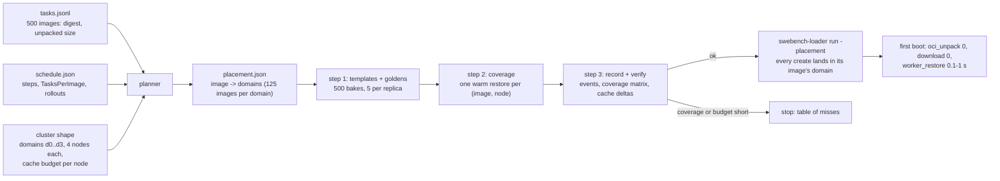
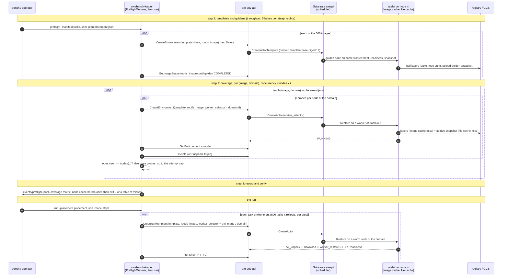

# PreflightWarmer: place task images across nodes before an RL job

Draft, 2026-11-02. First consumer: `swebench-loader` (the Fast rung of the RL benchmark ladder). The
component is the `PreflightWarmer`, the sibling of the fleet's `LookaheadWarmer`: that one keeps
instances ready, this one keeps node caches ready. Substrate facts below are from
`agent-substrate/substrate` main `24482d5d` (2026-11-02).

## Goal

Before a job starts, every task image the dataset needs is already unpacked in the image cache of
the nodes that will run it, and its golden snapshot is already in those nodes' file caches, so the
**first boot of an environment from that image** skips the pull, the unpack and the snapshot
download. The job then measures and trains on warm nodes from its first step, and the "first boot"
cost stops depending on where the scheduler happened to put the actor.

Non-goals for the first version: wake latency of suspended environments between episodes (already
pinned to the node with the local snapshot; the slow case is the detach to a full node, Substrate
issue #3482); Harbor, OpenHands and NeMo Gym jobs (they get the same machinery through the Python
fleet in a later phase); changing Substrate's scheduler (asks are listed at the end).

## What a first boot costs today

A `CreateEnvironment` with `rootfs_image` derives the template `<base>-<digest12>` once per image
and creates the actor; Substrate bakes a golden snapshot for the template in the background, 5 at a
time per ateapi replica, about two minutes each (`benchmarking/swebench/SKILL.md:33-36`). The actor
restores from the golden tag snapshot (or cold-boots while the bake runs) on whichever eligible
worker the scheduler picks. The restore timing breakdown atelet logs per actor
(`harvest-restore-timings.sh`, phases
`volume_mount, manifest_fetch, sandbox_assets, download, oci_unpack, worker_restore, persist, total`)
shows where the time goes on a cold node: `oci_unpack` (image layers not in the node's image cache;
~28 s for the images in Substrate issue #3482, minutes for the 9 GB images in sandboxenv-rl #200)
and `download` (the shared tag snapshot not yet in the node's file cache).

Placement is image-blind: "16 rollouts of one image land on 13 to 16 nodes"
(`benchmarking/swebench/SKILL.md:106-107`); "a restore lands on whichever node has room; if that
node has never pulled the image, the restore pulls it first"
(`benchmarking/swebench/README.md:99-100`). Nothing in sandboxenv-rl knows which node holds which
image, and `ate-env-api` does not report the node an environment ran on (`README.md:316-318`).

## Where TTFC goes, and what removes each part

Time to first command for a new environment of image X, in the order it is paid, with the lever for
each. PreflightWarmer is lever 3; it is the strongest client-side lever available on Substrate main,
not the whole answer.

| #   | Cost                                                                      | Size                                                                                                                     | Lever                                                                                                                                                                     | Where                                                                           |
| --- | ------------------------------------------------------------------------- | ------------------------------------------------------------------------------------------------------------------------ | ------------------------------------------------------------------------------------------------------------------------------------------------------------------------- | ------------------------------------------------------------------------------- |
| 1   | No golden yet: cold boot (container start + guest start + wakeup probe)   | 30–60 s on dense nodes (sandboxenv-rl #139)                                                                              | bake every golden before the run; bake throughput is 5 per ateapi replica. A golden saves the boot only on a node that already holds the layers (substrate#3481)          | PreflightWarmer step 1; substrate#3484                                          |
| 2   | First boot on the job's critical path at all                              | whatever 3–5 add up to                                                                                                   | pre-create the working set as suspended environments ahead of the step (`LookaheadWarmer`, `-prefetch`), so the trainer sees a wake (~0.2–1 s pinned) not a boot          | fleet SDK, loader; PreflightWarmer makes those creates cheap and the tail short |
| 3   | `oci_unpack`: layers not in the node's image cache                        | 1 ms with the layers on the node, 9–50 s without, 300 s under contention; ~97 % of a cold first command (substrate#3481) | put the layers on the nodes first (PreflightWarmer); upstream: image-aware placement (#298), lazy layers (EROFS, #2609), dedup of shared base layers already in the cache | this plan                                                                       |
| 4   | `download`: golden snapshot not in the node's file cache                  | snapshot size / GCS throughput                                                                                           | same pass fills it (shared tag snapshots are node-cached); upstream: hard links instead of copies (#2948)                                                                 | this plan                                                                       |
| 5   | `worker_restore`: memory restore of the golden                            | 0.1–1 s; a boot if the CPU family differs                                                                                | one CPU family per domain; small guest memory; MEMORY fidelity                                                                                                            | domains                                                                         |
| 6   | Wake moved to a cold node because the pinned node was full                | 36 k of 105 k wakes in one density run (#3482)                                                                           | per-environment selector keeps the detach inside the domain; upstream #3482, #3528                                                                                        | PR 1                                                                            |
| 7   | Task setup after boot (clone, install, test harness) repeated per rollout | seconds to minutes, × rollouts per task                                                                                  | a **task-level tag**: suspend the first rollout after setup, `CreateTag`, seed the other rollouts from it (`CreateActor --tag`); needs tag support in `ate-env-api`       | follow-up: sandboxenv-rl issue #206                                             |

Read the restore timing breakdown before choosing: if `oci_unpack` dominates, this plan pays; if
cold boots dominate, bakes do; if `worker_restore` dominates, the snapshot does.

## What exists

### sandboxenv-rl

| Piece                                                                                                                                          | What it does                                                                                | Gap for this feature                                                                                                     |
| ---------------------------------------------------------------------------------------------------------------------------------------------- | ------------------------------------------------------------------------------------------- | ------------------------------------------------------------------------------------------------------------------------ |
| `bench prewarm` (`cmd/benchmarking/bench/main.go:191-281`)                                                                                     | one probe create+delete per image: forces the derived template and starts the bake          | no node count, no node choice, no wait for the golden; `DESIGN.md:346-351` says "cached across nodes", the code does not |
| `swebench-loader resolve/run -prefetch` (`internal/benchmarking/swebench/workingset.go:437-520`)                                               | one parked sandbox per image of the next step                                               | placement-blind; one node per image                                                                                      |
| Python fleet `warm_pool`, `LookaheadWarmer` (`clients/python/src/ate_env/backend/substrate.py:502-600`, `lookahead.py`)                        | keeps N suspended environments per image ahead of the trainer's steps                       | placement-blind: "warm" means actors exist, wherever Substrate put them                                                  |
| `ate-env manifest template --workerpool` (`cmd/ate-env/manifest.go:781-783`)                                                                   | `ActorTemplate.workerSelector = {ate-env/workerpool: <pool>}`; derived templates inherit it | template-level only; no per-environment selector                                                                         |
| `sample-node-cache.sh`, `NodeCacheSample` (`benchmarking/swebench/sample-node-cache.sh`, `internal/benchmarking/swebench/report.go:3732-3760`) | per-node `ate_imagecache_requests_total{outcome}` deltas                                    | per node and outcome, not per image                                                                                      |
| `harvest-restore-timings.sh`, `schema.RestoreSample` (`internal/benchmarking/schema/measurements.go:136-150`)                                  | per-actor restore phases with `node` and `cache_hit`                                        | post-hoc only                                                                                                            |
| `make-dataset.py` (`benchmarking/swebench/make-dataset.py:133-149`)                                                                            | digest-pins every image with `crane digest`, dedups by digest                               | no image sizes                                                                                                           |

### Substrate main (24482d5d)

- **Per-actor placement constraint**: `Actor.worker_selector`
  (`api/ateapi/v1/ateapi.proto:560-568`), `match_labels` over worker labels, AND-ed with the
  template's selector, applied on the next `ResumeActor`.
  `kubectl ate update actor --worker-selector`.
- **Worker labels mirror the WorkerPool's labels**
  (`cmd/atecontroller/internal/workersync/syncer.go:332`, proto comment at `Worker.labels`). Node
  labels are not mirrored; nothing on main lets a selector name a node. A WorkerPool binds to nodes
  through `spec.template` nodeAffinity (`api/infra/k8s/ate/v1/workerpool_types.go:68-72`), so the
  placement unit a client can address is **a pool**, and a pool can be as small as one node.
- **Scheduler** (`cmd/ateapi/internal/scheduling/scheduling.go`): eligible = template selector ∧
  actor selector ∧ sandbox class/runtime ∧ `RequiredNodes`; among those with room, random sampling
  weighted by utilization. `RequiredNodes` is internal: the node a suspended actor's local snapshot
  sits on (`workflow_resume.go:567-583`). No image awareness.
- **Shared tag snapshots are node-file-cached**: a golden/tag snapshot is restored as
  `SNAPSHOT_SHARING_SHARED`, so atelet serves it from the node-local file cache after the first
  restore on that node (`workflow_resume.go:177-189`; #2796).
- **Image cache per node**: `internal/imagecache`, GC flags `--image-cache-gc-period` (5 m),
  `--image-cache-high-percent` (85), `--image-cache-low-percent` (80), `--image-cache-max-bytes`,
  `--image-cache-min-age` (2 m) (`cmd/atelet/imagegc.go:42-47`). Eviction skips layers an actor
  still references (`gc.go:619` refcount). Metric `ate.imagecache.requests{outcome}` per node; no
  per-image listing.
- **In flight upstream**: #298 prefer workers with cached images (open since Sep), #2512 prefer the
  node that cached a suspended actor's snapshot (WIP), #2970 compose scheduler constraints and order
  a pinned resume's fallbacks, #3002 index workers by node, issues #3482 (prefer a node with the
  image on detach), #3528 (suspended actors invisible to placement, so placement is "basically
  random").
- **"Tag a node"**: not on main. The closest mechanism today is a Kubernetes node label → a
  WorkerPool with nodeAffinity on it and a pool label → `Actor.worker_selector` on that label. If
  the TL means a specific PR or branch, this plan needs its link before P1 is final.

## Design

### Addressing a pool

A client can address a pool today, and will be able to address one more cheaply after one API
change:

| Mechanism                    | How                                                                                                                                                                                                                                                                                         | Cost                                                                                                                                                         | Status                                                     |
| ---------------------------- | ------------------------------------------------------------------------------------------------------------------------------------------------------------------------------------------------------------------------------------------------------------------------------------------- | ------------------------------------------------------------------------------------------------------------------------------------------------------------ | ---------------------------------------------------------- |
| **Base template per pool**   | `ate-env manifest template --template c4-d0 --workerpool c4-d0` writes `workerSelector {ate-env/workerpool: c4-d0}` (`cmd/ate-env/manifest.go:71, 783`); `CreateEnvironment{template: "c4-d0", rootfs_image: …}` derives `c4-d0-<digest12>` and the derived template inherits the selector. | one derived template and **one golden bake per (image, pool)**: bakes are the throughput limit, so this multiplies the slowest step by the number of domains | works on main today; the fallback and the first experiment |
| **Per-environment selector** | new `CreateEnvironmentRequest.worker_selector` → `Actor.worker_selector`, AND-ed with the template's (`ateapi.proto:560-568`). Pools carry two labels: the shared `ate-env/workerpool` the template selects, and a domain label such as `ate-env/domain: d0` the environment selects.       | one derived template and **one golden per image**, shared across domains (same sandbox class and CPU family required for a memory restore)                   | PR 1 below                                                 |

A golden baked under one template restores on any worker of the same sandbox class and CPU family,
so with the per-environment selector the domains share goldens; with the per-pool template they do
not. That difference, not the selector itself, is why PR 1 comes first.

### Placement domains

A **domain** is a WorkerPool (or a set of pools sharing a domain label) that the job addresses as
above. The cluster admin creates the domains once per cluster shape: `ate-env manifest` could render
N pools with a domain label each from one flag, or it stays an operator step (open). One node per
domain gives node-level placement at the cost of one WorkerPool object per node; a few nodes per
domain is the expected setting.

A **placement plan** maps each image to one or more domains:

```json
{ "schema_version": "v1",
  "domains": { "d0": {"labels": {"ate-env/workerpool": "c4-d0"}, "nodes": 4, "cache_bytes": 1.5e12}, ... },
  "images": { "ghcr.io/.../django@sha256:...": {"domains": ["d0","d3"], "unpacked_bytes": 2.1e9}, ... } }
```

The planner assigns images to domains by size-balanced bin packing under each domain's cache budget
(`nodes × cache_volume × low-percent − headroom`), with a replication factor per image from the
schedule's demand (`TasksPerImage`, rollouts, `max_concurrent`): hot images go to more domains.
Images that do not fit are reported, not silently dropped.

### The pre-flight pass

`PreflightWarmer` (Go, `internal/benchmarking/swebench/preflight.go`, next to `WorkingSet`), driven
by `swebench-loader preflight -manifest tasks.jsonl -plan placement.json -events-dir ...`:

1. **Templates and goldens.** For each image, create the derived template (one probe create, as
   `bench prewarm` does) and wait until its golden tag is `COMPLETED` (new `GetImageStatus` RPC,
   below). Bakes are the throughput limit (5 per replica, ~2 min): start them all first, overlap the
   rest with them, and print the projected bake time so an operator scales `ate-api-server` replicas
   before, not after.
2. **Coverage.** For each (image, domain): create probes concurrently with
   `worker_selector = domain.labels`, read the node each landed on (new `node` field on the
   environment), and repeat until every node of the domain has run the image once or an attempt cap
   is hit. Each probe's first boot is the cache fill: image layers into the node's image cache, the
   golden snapshot into its file cache. Probes are deleted as they complete (or parked, see "pin by
   parking").
3. **Record.** `events/preflight.jsonl`: per (image, node) attempt, duration, restore phases when
   harvestable; the node cache sample before and after; the final coverage matrix. `bench` Validity
   Rule 1 gets a real prewarm event per image and node instead of the synthetic `prewarmed-image`.
4. **Verify.** Fail the pre-flight (non-zero exit, clear table) when coverage is below the plan,
   when a domain's footprint exceeds its budget, or when the node cache deltas show evictions during
   the pass.

**Pin by parking (follow-up, sandboxenv-rl #229).** Leave one suspended probe per (image, node)
instead of deleting it: its local snapshot pins it to the node, its image layers stay referenced so
GC cannot evict them, and suspended actors do not count against worker capacity (Substrate issue
#3528). The first cut deletes every probe: the planner keeps each node under atelet's GC low
watermark, and a pinned probe costs a snapshot each (2,000 for SWE-bench Verified on four nodes per
domain) unless it uses the local suspend mode (#147). Pick it up when a measured run shows evictions
between the pre-flight and the run.

### The run

`swebench-loader run -placement placement.json` sets `worker_selector` per environment from its
image, so every create lands in a domain whose nodes hold the image; the scheduler still spreads
across the domain's nodes. `bench` scenarios get `preflight: {plan: ..., pin: bool}` so `bench run`
executes prewarm → preflight → measure in order and the report carries the coverage matrix. Without
a plan the loader behaves as today.

### Flow: SWE-bench Verified (500 instances) with PreflightWarmer

Inputs: `tasks.jsonl` from `make-dataset.py` (500 instances, one digest-pinned image each, unpacked
size per image), `schedule.json` from `swebench-loader resolve` (steps, `TasksPerImage`, rollouts),
and the cluster shape (domains with their node counts and cache budgets). The example numbers below
assume 16 worker nodes in 4 domains of 4, replication 1, ~3 GB unpacked per image, 2 ateapi
replicas; they are for the shape of the arithmetic, not measurements.





What each step costs for 500 images, with the example shape:

| Step          | Work                                                                                                                  | Time, example                                                                       | Knob                                                                                      |
| ------------- | --------------------------------------------------------------------------------------------------------------------- | ----------------------------------------------------------------------------------- | ----------------------------------------------------------------------------------------- |
| 1 goldens     | 500 bakes at ~2 min, 5 per replica                                                                                    | 2 replicas: 500 / 10 × 2 min ≈ **100 min**; 10 replicas ≈ 20 min; 1 replica ≈ 3.3 h | ateapi replicas (Substrate ask 5 for a flag)                                              |
| 2 coverage    | one restore per (image, node): 500 × 4 = 2,000 restores, 125 per node, each a ~3 GB pull + unpack (~20 s if IO-bound) | per node 125 × 20 s / k parallel ≈ **20 min at k=2**; all nodes in parallel         | k per node, node disk throughput, registry mirror                                         |
| disk per node | 125 images × 3 GB = 375 GB in the image cache, plus 125 golden snapshots in the file cache                            | needs a cache volume ≥ 375 / 0.80 ≈ **470 GB** below the low watermark              | more domains or replication < 1 (an image on a subset of the domain) when it does not fit |
| run           | per create: schedule + restore from caches + readiness                                                                | **~1–3 s** TTFC (to measure) instead of 30–90 s on a cold node                      | —                                                                                         |

Two things the diagram hides. Steps 1 and 2 overlap: a probe during the bake still fills the image
cache (it cold-boots), and a second, cheap probe after the golden is `COMPLETED` fills the file
cache; the warmer schedules the layer wave as soon as the bake queue is full and the snapshot wave
as goldens complete, so the wall time is closer to max(step 1, step 2) than their sum. The step 2
probes are deleted; pin-by-parking (#229) would keep them as 2,000 suspended environments pinned to
their nodes, holding their layers against GC, if cluster runs show evictions.

### API changes in `ate-env-api` (small, useful on their own)

- `CreateEnvironmentRequest.worker_selector` (`map<string,string>`), mapped to
  `Actor.worker_selector`; refused when the template has no pool label to narrow. CLI
  `ate-env create --worker-selector k=v`, Go and Python clients, `FleetConfig`.
- `Environment.node` (from `Actor.status.node_name`) in `GetEnvironment`, and a `node` label option
  on `ate_env_api_create_to_ready_seconds` (cardinality: nodes).
- `GetImageStatus(rootfs_image)` → derived template name, golden state (`PENDING|COMPLETED|FAILED`
  with the error message), golden tag name. Replaces the
  `kubectl-ate get actor-templates … goldenSnapshotStatus` loop the SKILL prescribes.

### Later: Python fleet

`FleetConfig.placement` (the plan file or dict) makes `warm_pool`, `acquire` and `LookaheadWarmer`
pass the image's domain selector, and `ate_env.PreflightWarmer`
(`clients/python/src/ate_env/preflight.py`, the shape of `lookahead.py`) runs the same coverage pass
from a trainer before its first step. `FleetConfig.node_selector` is already declared and reserved
(`config.py:201-205`); it becomes this.

## What this replaces or changes

Nothing is removed. One thing is subsumed, two change behaviour, the rest is additive.

| Existing                                                                                                                                 | Where                                                                                                | What happens to it                                                                                                                                                                                                                            |
| ---------------------------------------------------------------------------------------------------------------------------------------- | ---------------------------------------------------------------------------------------------------- | --------------------------------------------------------------------------------------------------------------------------------------------------------------------------------------------------------------------------------------------- |
| `bench prewarm` and `EnvBackend.Prewarm`: one probe create + delete per image                                                            | `cmd/benchmarking/bench/main.go:191-281`, `internal/benchmarking/swebench/backend.go:73-77, 165-179` | **Subsumed.** It is step 1 of the PreflightWarmer without the golden wait and without coverage. `bench prewarm` stays as the templates-only mode of the warmer (same flags, same `events/prewarm.jsonl`), so existing scenarios keep working. |
| `bench run` with `footing: warm` appends a synthetic `prewarm` event for image `prewarmed-image` so Validity Rule 1 passes               | `cmd/benchmarking/bench/run.go:270-285, 303-317`; `internal/benchmarking/DESIGN.md:447-450`          | **Changed.** When a `preflight:` step ran, the rule reads the real coverage events; the synthetic event remains only for scenarios without one, and the report says which.                                                                    |
| `FleetConfig.node_selector`, `tolerations`, `worker_family`: declared "reserved", never plumbed                                          | `clients/python/src/ate_env/config.py:201-205`, `backend/substrate.py:262-265`                       | **Changed.** `node_selector` gets its meaning (the per-environment `worker_selector`), fed by `FleetConfig.placement`. Unset keeps today's behaviour.                                                                                         |
| `SandboxFleet.preflight()` and the run report's `preflight` phase: connectivity checks (a `Get` on a random id)                          | `backend/substrate.py:237-254`, `docs/observability.md:205-210`                                      | **Kept, name collision noted.** The warmer is a class, `ate_env.PreflightWarmer`, and records its work under its own phases (`preflight_warm.golden`, `preflight_warm.coverage`), so the existing `preflight` phase keeps its meaning.        |
| `swebench-loader run -prefetch`, `WorkingSet.Prewarm`: one parked sandbox per image of the next step                                     | `internal/benchmarking/swebench/workingset.go:437-520`                                               | **Kept.** Instances, not caches; with `-placement` it passes the image's selector so the parked sandbox lands on a warm node.                                                                                                                 |
| `swebench-loader resolve` and `schedule.json` (`prefetch_images`, `TasksPerImage`)                                                       | `cmd/benchmarking/swebench-loader/main.go:315-359`, `schedule.go:245-266`                            | **Kept.** The planner reads the schedule for demand; the schedule format does not change.                                                                                                                                                     |
| `make-dataset.py` manifest                                                                                                               | `benchmarking/swebench/make-dataset.py:133-149`                                                      | **Additive.** One field per instance, the unpacked image size.                                                                                                                                                                                |
| `ate-env-api`: `CreateEnvironment`, `GetEnvironment`                                                                                     | `proto/ateenv/v1alpha/env.proto`                                                                     | **Additive.** `worker_selector` on create, `node` on get, a new `GetImageStatus` RPC. Callers that set neither see no change; the template-level selector stays the default.                                                                  |
| `ate-env manifest`: one WorkerPool with `ate-env/workerpool=<name>`                                                                      | `cmd/ate-env/manifest.go:71, 749, 783`                                                               | **Additive.** Pools can carry a second, domain label; a flag to render N domain pools is optional. Existing manifests are unchanged.                                                                                                          |
| Pre-run checklist item 3, counting goldens with `kubectl-ate get actor-templates`                                                        | `benchmarking/swebench/SKILL.md:30-36`                                                               | **Replaced in practice** by `GetImageStatus`; the checklist points at it.                                                                                                                                                                     |
| `DESIGN.md:346-351` ("prewarm … cached across nodes"), `:256-258`, `benchmarking/swebench/README.md:99-107` ("placement is image-blind") | docs                                                                                                 | **Made true, then updated.**                                                                                                                                                                                                                  |

## How this differs from `LookaheadWarmer`

`LookaheadWarmer` keeps **instances** ready: for the next steps' `{image: claims}` it holds that
many suspended environments per image so `acquire` does not wait for a create. It does not know
nodes; its environments land wherever the scheduler puts them, and the first boot of each still pays
the pull on a cold node. The pre-flight keeps **node caches** ready: it makes the nodes a job will
use already hold the image layers and the golden snapshot, so any create or detach that lands there
is fast. They compose: pre-flight first, then the warmer's creates are cheap, and with the placement
plan the warmer's environments land on warm nodes.

## Measurement and acceptance

Baseline and after, on the C4 bench cluster with the SWE-bench Verified manifest (the 2026-10-08 C4
concurrency run is the latest baseline record):

- First boot `create_to_ready` p50/p95 per image class (small / large), from the loader's events;
  the restore phases `oci_unpack_ms` and `download_ms` for first boots: target 0 and ≈0 for ≥ 99 %
  of first boots in the measured run.
- Node image-cache hit ratio during the run (`sample-node-cache.sh` deltas): target no misses after
  the pre-flight for planned images.
- Pre-flight cost: wall time, bytes pulled per node, probes created; bake wait vs coverage wait
  split.
- No DiskPressure, no atelet image-cache evictions during the run (`ate.filecache.evictions` and the
  image-cache GC log).

## Risks and open questions

- **Eviction between pre-flight and run.** GC runs every 5 min above 85 %, which is also kubelet's
  DiskPressure threshold, so an overshoot evicts pods, not only layers (substrate#3478: 40 nodes in
  DiskPressure at step 2 with 32 new images per step); a plan that fills a node past the low
  watermark is undone. The planner budgets below it, the verify step checks evictions, and
  pin-by-parking (#229) would remove the window.
- **Detach on wake still ignores images** (#3482). The per-environment selector narrows the detach
  to the domain, which holds the image; full fix is upstream.
- **Golden bake throughput.** Thousands of images mean hours at 5 per replica; the pre-flight must
  say so up front and the operator must scale replicas.
- **CPU family per domain.** A memory restore of a golden needs the family it was baked on; a domain
  must not mix families (`SKILL.md:44-47`).
- **WorkerPool management.** Domains are cluster objects; `ate-env manifest` could render N pools
  from one flag, or this stays an operator step. Open.
- **Which "tag a node"?** If Substrate gains per-actor node affinity or mirrors node labels into
  worker labels, domains collapse to node labels and the WorkerPool work disappears. Need the TL's
  pointer.
- **Image sizes.** The planner needs unpacked sizes; `make-dataset.py` can add them from the
  registry manifest (2–2.5× compressed as a fallback, `SKILL.md:41-42`).

## Substrate asks

Most of this already has an issue, several by Vicente from the 2026-10-30 density runs; the plan
cites those instead of filing twins (substrate#3481 was closed the same day as a duplicate of #276).

| Need                                                                                                | Upstream                                                       | Status                                                                                                                                                                                                                                                                      |
| --------------------------------------------------------------------------------------------------- | -------------------------------------------------------------- | --------------------------------------------------------------------------------------------------------------------------------------------------------------------------------------------------------------------------------------------------------------------------- |
| Image-aware placement: prefer a worker on a node that holds the image                               | substrate#276, PR #298                                         | open since Sep; #3481 (closed → #276) adds the measurements: `oci_unpack` 1 ms with the layers on the node, 9–50 s without (300 s under contention), ~97 % of a cold first command; a cold golden restore onto a cold node (16.6 s) was no faster than a cold boot (14.6 s) |
| Image-aware detach on wake; record the move on the actor                                            | substrate#3482                                                 | open                                                                                                                                                                                                                                                                        |
| Count suspended actors in placement                                                                 | substrate#3528                                                 | open                                                                                                                                                                                                                                                                        |
| Golden-bake concurrency as a flag; tell the caller golden vs boot                                   | substrate#3484                                                 | open; also the upstream half of `GetImageStatus`                                                                                                                                                                                                                            |
| Image-cache GC below kubelet's DiskPressure threshold                                               | substrate#3478                                                 | open; until then the SKILL's 30 s / 70 / 60 flags                                                                                                                                                                                                                           |
| Pull the image off the request path; "pre-warming a node should make it warm"                       | substrate#1383                                                 | open; the natural home for a prefetch-image RPC, as a comment, not a new issue                                                                                                                                                                                              |
| Per-node cached-image visibility                                                                    | substrate#276 needs atelet to report cached digests to ate-api | ask in a comment on #276 to expose that report (metric with the digest, or `Worker.status`)                                                                                                                                                                                 |
| **Per-actor node placement**: mirror node labels into `Worker.labels`, or a per-actor node affinity | none found                                                     | the one new issue to file; it is what makes domains unnecessary                                                                                                                                                                                                             |

## Work breakdown and status

Status as of 2026-11-02. Update this table when a row moves; it is the backlog.

| #   | Item                                                                                                                                                                                                                                                                                                                                                                                                                                                                                                                                                 | Size | Depends on       | Status                                                                                                                                                                                                                                                                                                                                                                                                                                                                              |
| --- | ---------------------------------------------------------------------------------------------------------------------------------------------------------------------------------------------------------------------------------------------------------------------------------------------------------------------------------------------------------------------------------------------------------------------------------------------------------------------------------------------------------------------------------------------------- | ---- | ---------------- | ----------------------------------------------------------------------------------------------------------------------------------------------------------------------------------------------------------------------------------------------------------------------------------------------------------------------------------------------------------------------------------------------------------------------------------------------------------------------------------- |
| 0   | Experiment, no code: base template per pool on the C4 cluster, two domains, ten images; restore timing breakdown before and after. Decides the replication factor and the domain size the planner starts from.                                                                                                                                                                                                                                                                                                                                       | —    | cluster time     | not started                                                                                                                                                                                                                                                                                                                                                                                                                                                                         |
| 1   | `ate-env-api`: `worker_selector` on `CreateEnvironment`, `node` and `worker_selector` on `Environment`; `ate-env create --worker-selector`, `ate-env get`; Go and Python clients                                                                                                                                                                                                                                                                                                                                                                     | M    | —                | **Merged** 2026-11-03 as #207 (main `9afd67b`)                                                                                                                                                                                                                                                                                                                                                                                                                                      |
| 2   | `ate-env-api`: `GetImageStatus` and `EnsureImageTemplate` (derived template, golden `NONE/PENDING/READY/FAILED`, tag, reason); feature `image_status`; `ate-env image-status`; clients                                                                                                                                                                                                                                                                                                                                                               | S    | 1 (shared proto) | **PR #209**, branch `api/image-status`, on `main` since #207 merged                                                                                                                                                                                                                                                                                                                                                                                                                 |
| 3   | `make-dataset.py`: `image_bytes_compressed` per instance from `crane manifest --platform`; `Instance.ImageBytesCompressed`                                                                                                                                                                                                                                                                                                                                                                                                                           | S    | —                | **Merged** 2026-11-03 as #208 (main `c0c41ac`)                                                                                                                                                                                                                                                                                                                                                                                                                                      |
| 4   | `PreflightWarmer` (`internal/benchmarking/swebench/preflight.go`) and `swebench-loader preflight`: the planner (`placement.json` from the manifest, the schedule and the cluster shape, under the per-node cache budget), the golden wait on `EnsureImageTemplate`/`GetImageStatus`, the coverage pass (probes with `worker_selector` until every node of a domain has run the image, node read back from `Environment.node`), delete or pin-by-parking, `events/preflight.jsonl`, the verify step. `bench prewarm` becomes its templates-only mode. | L    | 1, 2, 3          | 4a planner + `plan-placement`: **PR #212**, branch `swebench/preflight-planner`, on `main` since #208 merged (two-pass packing: coverage before replicas; `domains.json`; `image-placement.json` schema). 4b coverage pass + `swebench-loader preflight` + events + verify: **PR #218**, branch `swebench/preflight-warmer`, stacked on #212 and merged with #209 (`ImageWarmer` on `EnvBackend`, rounds held until placed, `preflight-coverage.json`, `-pin`, `-skip-golden-wait`) |
| 5   | `swebench-loader run -placement placement.json`; `bench` scenario step `preflight: {plan, pin}`; Validity Rule 1 reads real coverage events; `internal/benchmarking/DESIGN.md` and `benchmarking/swebench/README.md` updated to what is true                                                                                                                                                                                                                                                                                                         | M    | 1, 4             | `run -placement` (round-robin over the image's domains) and `report -preflight-coverage` (Rule 1 reads the pre-flight): **PR #219**, branch `swebench/run-placement`, stacked on #218. The `bench` scenario `preflight:` step and the docs rewrite wait for row 0's domain shape                                                                                                                                                                                                    |
| 6   | Measurement on C4: baseline vs PreflightWarmer with the acceptance criteria above, recorded next to the 2026-10-08 C4 run                                                                                                                                                                                                                                                                                                                                                                                                                            | —    | 4, 5             | not started                                                                                                                                                                                                                                                                                                                                                                                                                                                                         |
| 7   | Python fleet: `FleetConfig.placement`, `warm_pool`/`acquire`/`LookaheadWarmer`/`-prefetch` passing the image's selector, `ate_env.PreflightWarmer` with its own report phases                                                                                                                                                                                                                                                                                                                                                                        | M    | 1                | first slice **PR #211**, branch `fleet/placement`, on `main` since #207 merged (`node_selector` and per-image `placement` sent as the selector); `ate_env.PreflightWarmer` after row 4                                                                                                                                                                                                                                                                                              |
| 8   | Upstream (`agent-substrate/substrate`): comments on #276 (node placement and cached-image visibility for the unified node-locality design), #3484 (a second consumer for the bake flag and the golden-vs-boot signal), #1383 (prefetch-image RPC); file the per-actor node placement issue; cite #3482, #3478, #3528                                                                                                                                                                                                                                 | S    | —                | comments posted 2026-11-02; the node placement issue not filed yet                                                                                                                                                                                                                                                                                                                                                                                                                  |
| 9   | `ate-env manifest`: render N domain pools with a domain label from one flag (optional; an operator step until row 0 says how many domains a run wants)                                                                                                                                                                                                                                                                                                                                                                                               | S    | 0                | open question                                                                                                                                                                                                                                                                                                                                                                                                                                                                       |

Tracking issue: sandboxenv-rl #205. Follow-up: task-level tags, #206.
