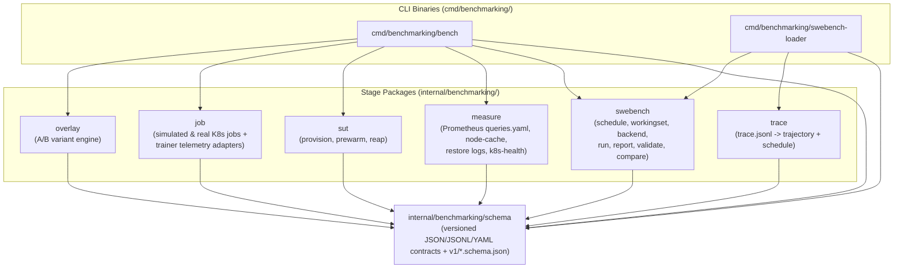
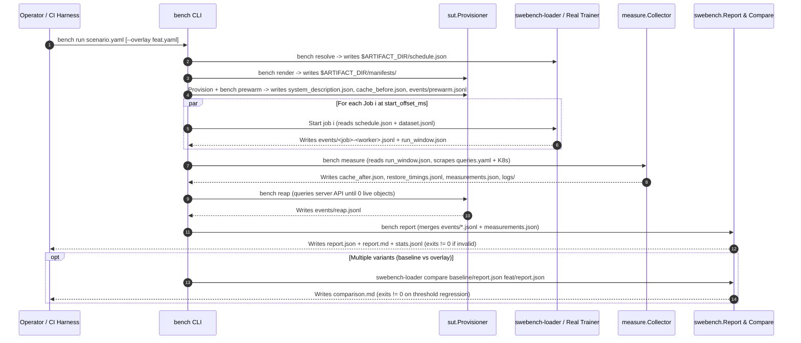
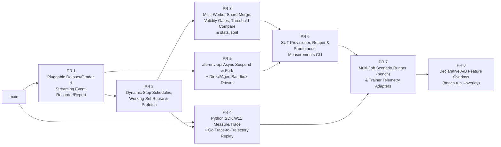

# Substrate RL Benchmark: Technical Implementation Plan

> **Note**: Authoritative system requirements, artifact contracts, and validity
> rules live in [`DESIGN.md`](./DESIGN.md). This `PLAN.md` is a technical
> implementation plan generated from `DESIGN.md` and may change as needed during
> implementation. It does not repeat the specification in `DESIGN.md`.

---

## 1. Baseline State on `main`

The following building blocks are already merged (or in-flight) on `main` and
serve as the foundation for all remaining work:

| Area | Existing Files on `main` | Capabilities Already Present |
|---|---|---|
| **Load generator & single-job runner** | `cmd/benchmarking/swebench-loader/main.go`<br>`internal/benchmarking/swebench/{backend,dataset,events,report,run,trajectory}.go` | Closed-loop `eval` and fixed-fleet `steps` execution against `ate-env-api` (`EnvBackend` with bearer-token auth); `-park` (`suspend`, `delete`, `none`); `-label KEY=VALUE` on `run` (`#105`); `-set KEY=VALUE` template variables and `-seed` trajectory mix (`#106`); `-images-per-step` rolling window (`#107`); Go template trajectory rendering; SWE-bench Python grader (`trajectories/swebench-grade.py`). |
| **Multi-run comparison, pooled arms & stragglers** | `internal/benchmarking/swebench/report.go` (`WriteComparison`, `Pool`, `Slowest`)<br>`cmd/benchmarking/swebench-loader/main.go` (`report A.jsonl B.jsonl`, `-arm`, `-top`) | Side-by-side table of 2+ runs via `swebench-loader report A.jsonl B.jsonl` (`main.go` calls `WriteComparison` for multiple files), pooled arm comparison via `swebench-loader report -arm NAME=FILE[,FILE...]`, and slowest first commands/wakes via `-top N` (`#105`). |
| **Node image-cache attribution** | `benchmarking/swebench/sample-node-cache.sh`<br>`internal/benchmarking/swebench/report.go` (`NodeCacheSample`, `CacheDelta`) | Before/after node `atelet` image-cache counter harvesting (`-cache-before`, `-cache-after`) and report delta calculation. |
| **Server restore-phase breakdown** | `benchmarking/swebench/harvest-restore-timings.sh`<br>`internal/benchmarking/swebench/report.go` (`RestoreTiming`, `JoinRestores`) | Harvesting `atelet` structured restore logs (`-restore-log`) and splitting client `ttfi` (first start) and `wake` (subsequent restores) into `manifest_fetch`, `download`, `oci_unpack`, `worker_restore`, and `outside`. |
| **Python SDK OTel spans** | `clients/python/src/ate_env/telemetry/tracing.py` | OpenTelemetry `ate_env_client.*` client/handle/driver spans with `ate_env.first_command`, `ate_env.exit_code`, `ate_env.timed_out`, and `ate_env.file.size` attributes. |
| **Python SDK fleet observability & Prometheus metrics** | `clients/python/src/ate_env/observability.py`<br>`clients/python/src/ate_env/telemetry/metrics.py` | `Observer` and dependency-free `RunReport`; lazy Prometheus histograms/counters (`ate_env_fleet_{phase,task,run}_latency_seconds`, `ate_env_fleet_{claims,tasks}_total`, `ate_env_fleet_release_failures_total` (`#115`), `ate_env_fleet_warm_replicas`, `ate_env_client_{acquire,exec,suspend,warm_claim,release}_seconds`); OTel `ate_env_fleet.<phase>` parent spans. |

---

## 2. Final Repository & Package Structure

Rather than creating a parallel load-generator tree, `internal/benchmarking/swebench` evolves in-place as the core execution, working-set, reporting, validation, and comparison library, while sibling packages under `internal/benchmarking/` implement orthogonal `DESIGN.md` stages that communicate through `$ARTIFACT_DIR` file contracts.

```text
cmd/
├── ate-env-api/
│   └── main.go                           # Serves Suspend DurabilityMode (async/sync) & snapshot-seeded ForkEnvironment RPCs
└── benchmarking/
    ├── swebench-loader/
    │   └── main.go                       # Load generator + standalone subcommands (resolve, convert-trace, compare)
    └── bench/
        └── main.go                       # Composable orchestrator CLI (resolve, render, prewarm, measure, reap, report, run)

internal/
├── apiservice/
│   └── server.go                         # Plumbs DurabilityMode and snapshot-seeded ForkEnvironment to internal/ate/client.go
├── ate/
│   └── client.go                         # Exposes SuspendAsync via existing c.suspend(...) and snapshot-seeded Fork (CreateActor with SourceTag)
└── benchmarking/
    ├── DESIGN.md                         # System design and specification
    ├── PLAN.md                           # This technical implementation plan
    ├── schema/                           # Versioned file-contract structs, strict JSON/JSONL codecs, embedded JSON Schemas
    │   ├── schema.go                     # Shared codec helpers (DecodeJSONStrict, ForEachJSONL, ValidateAgainstJSONSchema)
    │   ├── schedule.go                   # Schedule, ScheduledJob, ScheduledStep, ScheduledTask, PlacementPlan
    │   ├── event.go                      # Event (with sub-phases, source, tags/metrics maps), RunWindow
    │   ├── report.go                     # Report, ReportValidity, MetricSummary, StatsRow, SystemDescription, SandboxLifecyclePolicy
    │   ├── measurements.go               # Measurements, PrometheusSeries, NodeCacheArtifact, RestoreSample
    │   ├── scenario.go                   # Scenario, JobSpec, SUTSpec, FeatureOverlay, Thresholds, TelemetrySpec
    │   ├── trace.go                      # TraceEvent (SDK trace.jsonl contract)
    │   ├── validate_schema.py            # Python helper validating emitted JSON/JSONL against v1/*.schema.json
    │   ├── v1/                           # Canonical JSON Schema files (*.schema.json), embedded via //go:embed
    │   └── testdata/                     # Golden fixtures for every artifact contract
    ├── swebench/                         # Core load generator, working-set manager, dataset adapters, reporter & validator
    │   ├── dataset.go                    # Dataset-agnostic Instance + Adapter/Grader registry + SWEBenchAdapter
    │   ├── dataset_command.go            # Generic CommandAdapter for non-SWE-bench JSONL RL tasks
    │   ├── trajectory.go                 # Trajectory template rendering, Step.Think, per-kind RequireGrading
    │   ├── schedule.go                   # Deterministic schedule resolver (explicit, seeded sampler, fixed)
    │   ├── workingset.go                 # Client-side parked working set (match by image, wake/reset/fork, park/retire, async prefetch)
    │   ├── backend.go                    # Backend/Sandbox interfaces + EnvBackend (ate-env-api)
    │   ├── backend_drivers.go            # DirectSubstrateBackend + AgentSandboxBackend drivers
    │   ├── run.go                        # Modes: eval, steps (via WorkingSet + step_pause), open-loop (Poisson arrivals)
    │   ├── events.go                     # Buffered JSONL Recorder writing per-worker events/<worker>.jsonl shards + run_window.json
    │   ├── report.go                     # Streaming Builder, shard glob-merger, restore/cache joins, rollout & cost tables, stats.jsonl writer
    │   ├── validate.go                   # Validity Rules 1–7 evaluator over Report, Measurements, Schedule, and Scenario
    │   ├── compare.go                    # Report & custom_metrics comparator with threshold gating (exit code != 0 on regression)
    │   └── trajectories/                 # Embedded default trajectories & graders (swebench-gold.yaml, swebench-grade.py, workload-*.yaml)
    ├── trace/                            # Offline SDK trace-to-simulation converter
    │   ├── convert.go                    # Converts trace.jsonl -> Trajectory YAMLs (with Step.Think) + explicit schedule.json (with step_pause_ms)
    │   └── convert_test.go               # Round-trip chain test: trace.jsonl -> convert -> swebench.Run -> report
    ├── sut/                              # System Under Test provisioner, prewarmer, and server-truth reaper
    │   ├── sut.go                        # Provisioner (Render, Provision, Prewarm, DescribeSystem) for Substrate & Agent Sandbox
    │   └── reap.go                       # Timed polling loop verifying 0 remaining claims/sandboxes/templates/pools + events/reap.jsonl
    ├── measure/                          # Config-driven cluster, K8s, and server telemetry harvester
    │   ├── measure.go                    # PromQL range/instant client preserving 0 vs null/error, node-cache & restore-timings parsers
    │   ├── collector.go                  # Scoped Collector registry (prometheus, node-cache, restore-timings, k8s-health, substrate-control) & plugins
    │   ├── k8s.go                        # Deep K8s node/pod/PSI/API-server metrics, atelet log harvesting, and SandboxLifecyclePolicy extraction
    │   └── queries.yaml                  # Embedded default PromQL query catalog (ate_env_fleet_*, ate_env_client_*, ate_env_api_*, ate_*)
    ├── job/                              # Multi-job Scenario runner & live RL trainer telemetry adapters
    │   ├── job.go                        # Orchestrates staggered simulated and real K8s jobs with open-loop Poisson arrivals
    │   └── telemetry.go                  # Pluggable parsers converting :::MLLOG, Ray/VeRL logs, or step JSONL -> trainer events/*.jsonl
    └── overlay/                          # Declarative A/B Feature Overlay engine
        ├── overlay.go                    # Applies Helm values & JSON6902/Kustomize patches, runs lifecycle hooks, harvests custom_metrics
        └── overlay_test.go

clients/python/src/ate_env/
├── observability.py                      # Existing Observer & RunReport; extended with step-boundary events/*.jsonl flush in measure mode
└── telemetry/
    ├── __init__.py
    ├── metrics.py                        # Existing ate_env_fleet_* & ate_env_client_* Prometheus metrics; extended with slot_wait/wire_claim/ready_to_first_command & source attribution
    ├── tracing.py                        # Existing OTel span helpers
    └── trace_recorder.py                 # Lightweight OTel SpanProcessor / hook writing schema-compliant trace.jsonl when ENV_BENCH_MODE=trace
```

---

## 3. Component Interactions & Dependency Boundaries

### 3.1 Compile-Time Import Rules (Strict DAG)

1. **One-Way Dependency from Benchmark to SDK/Service**:
   - Benchmark packages (`cmd/benchmarking/*`, `internal/benchmarking/*`) may depend on `ateenv.v1alpha` protos and client libraries.
   - Core service and SDK packages (`internal/apiservice`, `internal/ate`, `clients/python/src/ate_env`) **never** import benchmark packages.
   - In Python, `ate_env` exposes general-purpose observability (`observability.py`, `telemetry/metrics.py`, `telemetry/tracing.py`, and the opt-in `telemetry/trace_recorder.py` span exporter). It has zero knowledge of SWE-bench, datasets, or `bench` scenarios.
2. **Leaf Schema Package (`internal/benchmarking/schema`)**:
   - `internal/benchmarking/schema` depends only on the Go standard library, `sigs.k8s.io/yaml`, and `github.com/google/jsonschema-go/jsonschema` (`github.com/google/jsonschema-go` is already in `go.mod` at `v0.4.3` as an indirect dependency via the MCP SDK, so PR 2 adds no new external module).
   - Every stage package (`swebench`, `trace`, `sut`, `measure`, `job`, `overlay`) imports `internal/benchmarking/schema` for wire types, **never** importing another stage package to pass in-memory state across stage boundaries.



### 3.2 Runtime Stage Interaction (File-Only Contracts in `$ARTIFACT_DIR`)

At runtime, stages never pass Go structs in memory across lifecycle boundaries; every stage reads its inputs from `$ARTIFACT_DIR` (or `--dest`) and writes its outputs back to `$ARTIFACT_DIR`:



---

## 4. Technical Design of Key Subsystems

### 4.1 Park Policies & Backend Driver Plumbing (`internal/ate`, `internal/apiservice`, `swebench/backend.go`)
- **Proto & API Service (`proto/ateenv/v1alpha/env.proto`)**:
  - Add `SuspendDurabilityMode` (`SUSPEND_DURABILITY_MODE_UNSPECIFIED`, `SUSPEND_DURABILITY_MODE_SYNCHRONOUS`, `SUSPEND_DURABILITY_MODE_ASYNCHRONOUS`) to `SuspendEnvironmentRequest` and add `ForkEnvironment(ForkEnvironmentRequest) returns (ForkEnvironmentResponse)` in `ateenv.v1alpha`.
  - `internal/ate/client.go` already has `suspend(ctx, atespace, id, mode)` (where `Suspend` passes `SYNCHRONOUS` and `Delete` passes `ASYNCHRONOUS`); PR 5 adds `SuspendAsync` and plumbs the proto field through `internal/apiservice/server.go`.
- **Substrate `ForkActor` Dependency & Fallback (`DESIGN.md` W1, W3, W8)**:
  - Substrate v0.6.0's `Control` service exposes `Create`, `Delete`, `Get`, `List`, `Resume`, `Revert`, `Suspend`, and `Update` for actors, and has **no `ForkActor` RPC**. Per the repository rule (no Substrate design change unless a bug fix or mandatory), native server-side `fork` is **blocked on Substrate** (note that `DESIGN.md` W1, W3, and W8 also assume fork and share this dependency).
  - The fallback implemented today without modifying Substrate is a fresh `CreateActor` seeded from a template/actor whose golden or latest snapshot (`Actor.SourceTag`) is already baked (suspending the source actor asynchronously first only if no snapshot exists yet), measured under its own acquisition `source`, while keeping the `ParkPolicy` (`fork`) value reserved in `internal/benchmarking/schema`.
- **Loader `Backend` Interface (`internal/benchmarking/swebench/backend.go`, `backend_drivers.go`)**:
  - Extend `Sandbox` / `Backend` with `SuspendWithMode(ctx, mode ParkPolicy) error`, `Fork(ctx, newID string) (Sandbox, error)`, and `Prewarm(ctx, images []string) error`.
  - Provide drivers for `ate-env-api` (`EnvBackend`), direct Substrate control plane (`DirectSubstrateBackend`), and Kubernetes Agent Sandbox CRDs (`AgentSandboxBackend`).

### 4.2 Schedule Resolver & Steps-Mode Working Set (`swebench/schedule.go`, `swebench/workingset.go`)
- **Schedule Resolution (`schedule.go`)**:
  - Accepts `explicit` per-step task lists, `sampled` (deterministic `math/rand/v2` seeded PRNG sampling `tasks_per_step` instances $\times$ `group_size` rollouts per step from the dataset manifest and trajectory pool), or `fixed` (repeating the same slice every step).
  - Always writes `$ARTIFACT_DIR/schedule.json` before execution so repeated runs or baseline-vs-overlay variants replay the exact same per-step image sequence.
- **Client-Side Working Set (`workingset.go`)**:
  - Maintains `parkedByImage map[string][]*parkedSandbox` across steps.
  - At step $s$:
    1. **Match**: Partitions step $s$'s scheduled tasks into **hits** (popping a parked sandbox with matching `Image`) and **misses**.
    2. **Async Prefetch & Retire (Off Critical Path)**: If `-prefetch` is enabled and step $s+1$ exists in `schedule.json`, spawns a background goroutine at step start that computes the image delta `need(s+1) \ active(s)` and calls `Backend.Prewarm`, recording `prefetch_lead_margin_ms = step_s_end_ts - prewarm_ready_ts`. Surplus sandboxes not needed in $s$ or $s+1$ are retired asynchronously, tracking `release_overlap_ms`.
    3. **Execute Rollouts**: Wakes + resets (or snapshot-forks when `park == "fork"`) hit sandboxes and creates miss sandboxes up to `-max-concurrent`, recording `slot_wait_ms` (time waiting on the concurrency semaphore) separately from wire `create`/`wake` and `ttfi`.
    4. **Step Barrier & Park**: Waits for all rollouts in step $s$ to complete, parks active sandboxes according to `ParkPolicy` (`suspend`, `suspend-async`, `suspend-sync`, `fork`, `delete`, `none`), sleeps `step_pause_ms` to simulate trainer gradient + weight sync, and emits a coarse `step` event with working-set hit rate, standing pool size, and churn counts.

### 4.3 SDK Telemetry & Trace-to-Trajectory Converter (`clients/python`, `internal/benchmarking/trace`)
- **Reusing Existing Python SDK Observability (`measure` mode — `W11`)**:
  - `clients/python/src/ate_env/observability.py` and `telemetry/metrics.py` already provide `Observer`, `RunReport`, `ate_env_fleet_*`, and `ate_env_client_*` Prometheus collectors, and `telemetry/tracing.py` already instruments every SDK call with OpenTelemetry spans.
  - Rather than adding a parallel metrics stack, PR 4 extends `observability.py` and `telemetry/metrics.py` with:
    1. Sub-phase attribution histograms on acquire (`ate_env_client_slot_wait_seconds`, `ate_env_client_wire_claim_seconds`, `ate_env_client_ready_to_first_command_seconds`) labeled by bounded acquisition `source` (`warm_pool`, `cold_create`, `mock`, `direct`).
    2. Step-boundary JSONL summary flushing (`flush_step_events`) when `ENV_BENCH_EVENTS_PATH` is set.
- **SDK Call Trace Recorder (`trace` mode — `W11`)**:
  - `clients/python/src/ate_env/telemetry/trace_recorder.py` attaches an OpenTelemetry `SpanProcessor` to `tracing.py`'s existing spans when `ENV_BENCH_MODE=trace`, serializing each completed `ate_env_client.*` and `ate_env_fleet.*` span as a `TraceEvent` line in `$ARTIFACT_DIR/trace.jsonl`.
- **Trace Converter (`internal/benchmarking/trace/convert.go` — `W12`)**:
  - Streams `trace.jsonl`, groups calls by `(job, step, env_id)`, computes `Step.Think` as the timestamp gap between consecutive sandbox operations on the same environment (capturing LLM/sampler think time), computes `step_pause_ms` as the gap between step rollout barriers, writes one replayable `Trajectory` YAML per distinct call pattern, and emits `$ARTIFACT_DIR/schedule.json`.

### 4.4 Streaming Reporter, Validator & Comparator (`swebench/report.go`, `validate.go`, `compare.go`)
- **Streaming Aggregation**:
  - `SummarizeDir(eventsGlob)` streams all `$ARTIFACT_DIR/events/*.jsonl` worker shards + `prewarm.jsonl` + `reap.jsonl` through `Builder.Add(ev)` without loading full event slices into memory, retaining raw duration slices per `(job, op, source)` to compute exact `p50`/`p90`/`p95`/`p99`/`max` percentiles while preserving `swebench-loader report`'s `Pool` (`-arm`) and `Slowest` (`-top`) capabilities from `#105`.
- **Rollout Decomposition & Cost Joins**:
  - Joins `Measurements` (`cache_before.json`, `cache_after.json`, `restore_timings.jsonl`, and `measurements.json` Prometheus series) with raw events to populate TTFI sub-phase tables, per-step `p50`/`p100` straggler skew and `env_overhead_pct`, active vs. parked sandbox density, node-hours per completed task, `SandboxLifecyclePolicy` summary, and cross-job interference buckets (grouping operation latencies by the number of concurrently active jobs `[1, 2, 3+]`).
- **Dual Output (`report.json` + `stats.jsonl`)**:
  - Emits structured `report.json`, human-readable `report.md`, and flat `StatsRow` lines in `stats.jsonl` (`trial_summary`, `server_summary`, `phase_breakdown_summary`, and `custom_metrics`).

---

## 5. High-Level Vertical PR Breakdown

To keep reviews small, self-contained, and easy to verify, **every PR delivers one vertical end-to-end capability** (CLI flag/subcommand $\to$ core execution $\to$ report output + **only** the `internal/benchmarking/schema` types that PR reads or writes). No PR introduces unused schema files or interfaces without a caller.

### In-Flight & Recently Merged PRs

The table below maps overlapping PRs on `main` (merged or open) to the vertical PR in this plan that integrates, extends, or supersedes them:

| PR | Scope on `main` | Relationship to Plan PRs |
|---|---|---|
| **#105** *(merged)* | Run event labels (`-label`), pooled multi-rep arm comparisons (`report -arm`), and slowest environments (`report -top`). | Preserved in **PR 1** and extended by **PR 3** (`compare` threshold gating & `stats.jsonl`) and **PR 8** (multi-variant `bench` comparisons). |
| **#106** *(open)* | Trajectory template variables (`-set KEY=VALUE`) and seeded trajectory mix per environment (`-seed`). | Overlaps and feeds **PR 2**, which uses seeded deterministic sampling across the dataset and trajectory pool to emit `schedule.json`. |
| **#107** *(open)* | Rolling window of new images per step (`-images-per-step`), creating fresh environments and retiring after the step in `run.go`. | **PR 2** extends this rolling-window pattern into `schedule.json` + the image-matched `WorkingSet` (which supports both fresh-retire and parked reuse across steps). |
| **#103** *(open)* | Python SDK benchmark telemetry. | Covered by **PR 4**, keeping a single `Observer` / `telemetry` output path as requested in the `#103` review (Section 4.3). |
| **#114** *(open)* | `ate-env-api` OpenTelemetry tracing and `ate_env_api_*` Prometheus metric families (`requests_total`, `request_duration_seconds`, `create_to_ready_seconds`, `wake_wait_seconds`, `environments`, `build_info`). | Read by **PR 6**'s embedded Prometheus query catalog (`internal/benchmarking/measure/queries.yaml`). |
| **#115** *(merged)* | `ate_env_fleet_release_failures_total` counter in `clients/python/src/ate_env/observability.py`. | Included in the Section 1 baseline and scraped by **PR 6**'s `internal/benchmarking/measure/queries.yaml`. |

### PR Sequence & Dependency Graph



### Detailed PR Plan

| PR | Work Items (`DESIGN.md`) | Title / Vertical Slice | End-to-End Capability Added | Files & Packages Touched | Schema Slice Included | End-to-End Verification Gate |
|---|---|---|---|---|---|---|
| **PR 1** | `W2`, `W5`, `W6`, `M1` | **Pluggable Dataset/Grader Registry & Streaming Event/Report Engine** | Decouples `swebench` execution/reporting from SWE-bench-specific JSON fields via per-kind `Adapter`/`Grader` registry; adds generic `command` dataset adapter alongside `swebench`; makes `Recorder` buffered and `Summarize` streaming while preserving `#105` (`-label`, `-arm`, `-top`). | `internal/benchmarking/swebench/{dataset,dataset_command,trajectory,events,report,run,backend}.go` | Existing `Event`, `Summary`, `Instance` (in-place). | Run `swebench-loader` on both a SWE-bench manifest and a non-SWE-bench command manifest; verify grading and streaming `Summarize`. |
| **PR 2** | `W1`, `W3`, `M1`, `M2` | **Dynamic Per-Step Schedules, Parked Working Set & Async Prefetch** | Adds `swebench-loader resolve` and `-schedule` / `-tasks-per-step` / `-group-size` / `-step-pause` / `-prefetch`, and extends `-park` (`suspend`, `delete`, `none`) with `suspend-async`, `suspend-sync`, and `fork`. Extends `steps` mode with an image-matched parked `WorkingSet` and off-critical-path next-step prefetch; reports working-set hit rate, churn, and prefetch lead margin. | `cmd/benchmarking/swebench-loader/main.go`<br>`internal/benchmarking/schema/{schema,schedule}.go`<br>`internal/benchmarking/swebench/{schedule,workingset,run,report}.go` | `schedule.schema.json` (`Schedule`, `ScheduledJob`, `ScheduledStep`, `ScheduledTask`, `ParkPolicy`) + working-set `Event`/`Summary` fields. | Resolve a seeded multi-step schedule with changing images per step $\to$ run `swebench-loader -mode steps -schedule schedule.json -prefetch` against mock/fake backend $\to$ verify positive prefetch lead margin, working-set reuse hit rate, and `go test -bench` throughput. |
| **PR 3** | `W5`, `W6`, `W7`, `M2`, `M3` | **Multi-Worker Shard Merging, Validity Gates, Regression Compare & `stats.jsonl`** | Adds glob-merging of `events/*.jsonl` shards, `run_window.json` emission, Validity Rules 1–7 (`-validate`), threshold-gated `swebench-loader compare -thresholds T.yaml` (non-zero exit on regression), per-step rollout `p50`/`p100` straggler decomposition, `SandboxLifecyclePolicy` reporting, and `-stats-out stats.jsonl`. | `cmd/benchmarking/swebench-loader/main.go`<br>`internal/benchmarking/schema/{event,report}.go`<br>`internal/benchmarking/swebench/{events,report,validate,compare}.go` | `event.schema.json`, `run_window.schema.json`, `report.schema.json`, `stats_row.schema.json`. | Feed multi-worker `events/*.jsonl` + `cache_before/after.json` + `restore_timings.jsonl` into `swebench-loader report -validate -stats-out stats.jsonl` $\to$ verify validity pass/fail reasons, `stats.jsonl` schema compliance, and non-zero exit when `compare` detects a planted regression. |
| **PR 4** | `W11` (`measure` & `trace` modes), `W12`, `M4` | **Python SDK `W11` Measure/Trace Telemetry & Trace-to-Trajectory Replay** | Extends `ate_env` (`observability.py` / `telemetry/metrics.py`) with `W11` measure-mode sub-phase histograms (`slot_wait_seconds`, `wire_claim_seconds`, `ready_to_first_command_seconds`), bounded acquisition `source` labels, and step-boundary JSONL flushing (`ENV_BENCH_EVENTS_PATH`), plus `ENV_BENCH_MODE=trace` span recording (`trace_recorder.py` $\to$ `trace.jsonl`) and `swebench-loader convert-trace` emitting `Trajectory` YAMLs (`Step.Think`) and `schedule.json` (`step_pause_ms`). | `clients/python/src/ate_env/{observability.py,telemetry/metrics.py,telemetry/trace_recorder.py}`<br>`internal/benchmarking/schema/{trace.go,validate_schema.py}`<br>`internal/benchmarking/trace/convert.go`<br>`cmd/benchmarking/swebench-loader/main.go` | `trace_event.schema.json` (`TraceEvent`). | End-to-end chain test: Python `ate_env` session emits `W11` measure-mode sub-phase/step events and `trace`-mode `trace.jsonl` (validated against `trace_event.schema.json`) $\to$ `swebench-loader convert-trace` emits `Trajectory` + `schedule.json` $\to$ `swebench-loader` replays it and reproduces step count, concurrency curve, and think times. |
| **PR 5** | `W3`, `W8`, `M2` | **Async/Sync Suspend & Snapshot-Seeded Fork in `ate-env-api` + Backend Drivers** | Plumbs `SuspendEnvironmentRequest.DurabilityMode` (`ASYNCHRONOUS` vs `SYNCHRONOUS`) and `ForkEnvironment` (implemented via snapshot-seeded `CreateActor` with `SourceTag` while native Substrate `ForkActor` remains blocked on Substrate v0.6.0) through `proto/ateenv/v1alpha/env.proto`, `internal/apiservice/server.go`, `internal/ate/client.go`, and `EnvBackend`, and adds `DirectSubstrateBackend` / `AgentSandboxBackend` drivers. | `proto/ateenv/v1alpha/env.proto`<br>`internal/ate/client.go`<br>`internal/apiservice/server.go`<br>`internal/benchmarking/swebench/backend*.go` | None (uses `ParkPolicy` from PR 2). | Unit and fake-control-plane tests exercising `suspend-async`, `suspend-sync`, and snapshot-seeded `fork` end-to-end from `swebench-loader` through `apiservice` to `fakecontrol`. |
| **PR 6** | `W4`, `W8`, `W9`, `W10`, `M3`, `M5` | **Composable SUT Provisioner, Reaper & Measurements CLI (`bench`)** | Introduces `cmd/benchmarking/bench` with standalone `render`, `prewarm`, `measure`, and `reap` subcommands: renders SUT manifests, prewarms templates/pools (`events/prewarm.jsonl`), scrapes Prometheus using embedded `internal/benchmarking/measure/queries.yaml` (`ate_env_fleet_*` including `#115` `ate_env_fleet_release_failures_total`, `ate_env_client_*`, and `#114` `ate_env_api_*`) + K8s/Substrate collectors (`measurements.json` & `system_description.json`), and runs timed server-queried `reap` to zero orphans (`events/reap.jsonl`). | `cmd/benchmarking/bench/main.go`<br>`internal/benchmarking/schema/measurements.go`<br>`internal/benchmarking/sut/*.go`<br>`internal/benchmarking/measure/{measure.go,collector.go,k8s.go,queries.yaml}` | `measurements.schema.json`, `node_cache.schema.json`, `restore_sample.schema.json`, `system_description.schema.json`. | Hermetic test against fake Prometheus + fake K8s/Substrate API verifying `bench prewarm`, `bench measure` (including `queries.yaml` catalog and failed-scrape rejection), and `bench reap` converging to 0 server-side orphans and attaching to `bench report`. |
| **PR 7** | `W4`, `W13`, `W14`, `M4`, `M5` | **Multi-Job Scenario Runner (`bench run`) & Live Trainer Telemetry Adapters** | Adds `bench run scenario.yaml` to orchestrate 1..N staggered simulated or real jobs (`internal/benchmarking/job`), cross-job interference tables in `report.go`, open-loop Poisson arrivals (`-mode open-loop`), and trainer step-log adapters (`:::MLLOG`, Ray/VeRL logs, structured step JSONL). | `cmd/benchmarking/bench/main.go`<br>`internal/benchmarking/schema/scenario.go`<br>`internal/benchmarking/job/*.go`<br>`internal/benchmarking/swebench/{run,report}.go` | `scenario.schema.json` (`Scenario`, `JobSpec`, `SUTSpec`). | Run `bench run` with two offset simulated jobs + a `:::MLLOG` real-trainer fixture $\to$ verify rendered K8s `Job` manifests, cross-job interference latency buckets, trainer step breakdown (`rollout`/`weight_sync`/`train`, `env_overhead_pct`), and zero-orphan reap. |
| **PR 8** | `W15`, `M6` | **Declarative A/B Feature Overlays (`bench run --overlay`)** | Adds `--overlay feature.yaml` and `variants:` support (`internal/benchmarking/overlay`): resolves `schedule.json` once, applies Helm/Kustomize/JSON6902 `sut_overrides`, runs `pre_provision`/`post_provision`/`pre_reap`/`post_teardown` hooks, harvests overlay `diagnostics` into `custom_metrics`, and runs `compare` across variants. | `internal/benchmarking/overlay/*.go`<br>`cmd/benchmarking/bench/main.go`<br>`internal/benchmarking/sut/sut.go`<br>`internal/benchmarking/measure/collector.go`<br>`benchmarking/SKILL.md` | `FeatureOverlay` fields in `scenario.schema.json`. | End-to-end A/B test over base scenario + feature overlay fixture verifying shared `schedule.json`, manifest patching, custom `reap_resources` reaching zero, `custom_metrics` in `report.json`/`stats.jsonl`, and side-by-side `compare` output. |
